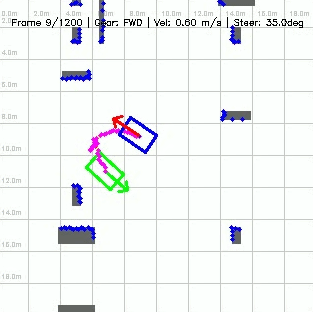
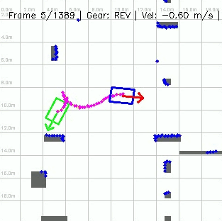

# Path planning with Flow-Matching

The aim of this project is to demonstrate how Machine Learning (ML) can perform similar tasks to traditional path planning algorithms (such as A* [1], Hybrid A*, or RRT [2]). Performance comparison is out of scope; the focus is on the ML concept.

What the system does:
- Scans a parking lot ($W \times H$) to obtain free space (e.g., via 2D LiDAR).
- Given a target **GOAL** pose $(x, y, \theta)$, generates a collision-free path from **START** to **GOAL**.
- A virtual vehicle executes and follows that path using a closed-loop kinematic controller until the goal is reached.

 

### How to Use

The repository provides an end-to-end pipeline:
1. **Dataset Generation:** Use `dataset_generator.py` to generate training and testing datasets.
2. **Model Training:** Train the flow-matching model using `train.py`.
3. **Simulation:** Run `simulator_cv.py` to evaluate and visualize closed-loop vehicle execution.
4. **Configuration:** Adjust parameters, vehicle dimensions, and lot limits in `constants.py`.

### Architecture

The system consists of three main components:
- **Pre-processing / Data Preparation:** LiDAR normalization, coordinate transformation, and relative pose encoding.
- **Model / Path Generation:** Continuous Flow-Matching trajectory prediction conditioned on obstacles and target goal.
- **Post-processing & Control:** Kinematic curvature clamping, terminal slot axis alignment, and closed-loop trajectory tracking using a Stanley controller.

The model uses **Continuous Flow-Matching (FM) with Classifier-Free Guidance (CFG)**, capable of modeling arbitrary probability paths. Compared to diffusion-based approaches, FM eliminates stochastic noise during inference, which speeds up training and allows simple ODE solvers (e.g., Euler, Heun) to sample trajectories efficiently.

#### Inference & ODE Trajectory Sampling

During inference, trajectories are integrated from prior Gaussian noise to the data distribution using numerical ODE solvers:
- **Solvers Supported:** **Heun's 2nd-order predictor-corrector** (default, higher precision) or **Euler's method** (fastest).
- **Integration Steps (`steps=10..20`):** Typically 10 to 20 discretization steps are sufficient to produce clean, high-fidelity trajectories (compared to 50–100+ steps in traditional diffusion models).
- **Classifier-Free Guidance (`cfg_scale=1.5`):** Blends the conditioned velocity vector field with the unconditional field.

#### Model Properties

##### Inputs

| Input Name | Shape | Description |
|------------|-------|-------------|
| **tau_t** | `(B, 40, 6)` | Noisy trajectory state at step $t$ ($x, y, \cos\theta, \sin\theta, v, \delta$) |
| **t** | `(B, 1)` | Diffusion / flow timestep $t = [0, 1]$ |
| **point_cloud_scan** | `(B, 1, 360)` | 2D LiDAR scan range array (360 beams) |
| **rel_target_pose** | `(B, 4)` | Relative target pose $(\Delta x, \Delta y, \Delta\cos\theta, \Delta\sin\theta)$ |
| **cond_mask** | `(B, 1)` | Classifier-Free Guidance mask ($0 = \text{unconditional}$, $1 = \text{conditioned}$) |

##### Output

| Output Name | Shape | Description |
|-------------|-------|-------------|
| **output** | `(B, 40, 6)` | Predicted velocity vector field / denoised trajectory |

##### Model Parameters

| Metric | Value |
|--------|-------|
| **Total Parameters** | 652,505 |
| **Trainable Parameters** | 652,505 |
| **Model Size (FP32)** | 2.49 MB |
| **Model Size (FP16)** | 1.24 MB |
| **Total MACs**| ~156.6 M (at $40 \times 6$ input) |

<i><b>Note:</b> Parts of this project were generated and refined using AI tools.</i>

### References
1. [simpleAstar](https://github.com/fvilmos/simpleAstar)
2. [Rapidly-Exploring Random Tree](https://github.com/fvilmos/rapidly_exploring_random_tree)
3. [Flow Matching for Generative Modeling](https://arxiv.org/html/2210.02747v2)